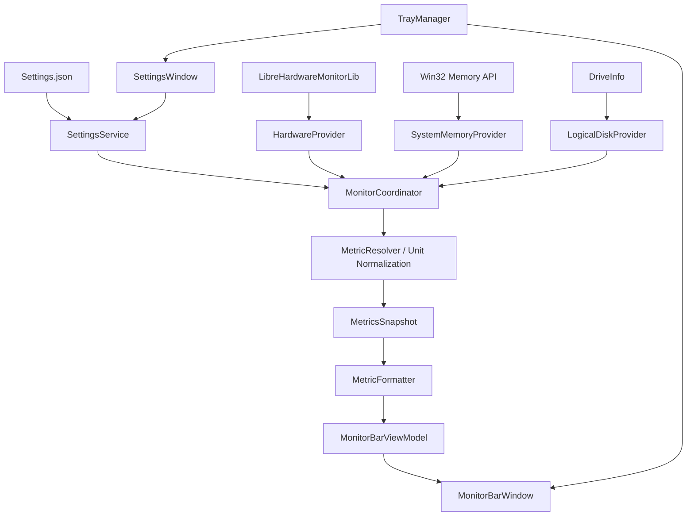

# SysMonitorBar — Windows 单行资源监控工具详细设计 v1.0

> 状态：设计基线（可交付 Codex / Claude 按阶段实现）
> 目标平台：Windows 10 / 11 x64；C# / .NET 10 / WPF
> 界面语言：默认简体中文；代码、类型名称和项目文档中的技术标识使用英文。

## 1. 项目定位与边界

制作一个**轻量、常驻系统托盘、没有传统主窗口**的 Windows 桌面监控程序。正常使用时仅呈现一条可拖动的文字悬浮条：

```text
CPU 18% | GPU 6% | RAM 9.2/16 GB | VRAM 2.1/16 GB | C: 62%
```

- 悬浮条：无标题栏、无任务栏按钮、圆角、单行不换行；可自由拖动，可设置背景透明度；可设置置顶。
- 系统托盘：始终存在。右键提供显示/隐藏、设置、开机启动、退出。
- 设置窗口：以 Checkbox 选择显示的指标和磁盘分区，可改变背景透明度、字号、位置相关行为及采样周期，实时预览、持久保存。
- 监控数据：CPU/GPU/RAM/VRAM/硬盘空间；可选温度、磁盘 I/O、网络吞吐；**显示不了的传感器要以 `--` 标记而不是虚构 0**。
- 保持单进程、本地运行；**不设计**安装服务、数据库、远程控制、浏览器界面、复杂插件系统、历史曲线、服务器或管理员强制启动。

## 2. 用户场景与验收

### 2.1 核心场景

1. 用户启动 `SysMonitorBar.exe`：托盘图标出现，按上次配置恢复悬浮条显隐和位置。
2. 悬浮条默认显示 CPU、GPU、RAM、VRAM 和 C: 空间占比，采集周期 1 秒；一行显示、没有多余按钮。
3. 用户按住悬浮条任意可点击区域左键拖动，松开后记录位置；再次启动恢复。
4. 用户右键托盘图标选择「隐藏悬浮条」，只隐藏窗口不退出；「显示悬浮条」恢复。
5. 用户从托盘选择「设置…」，打开独立设置窗口，通过复选框选择显示项、拖动滑块调整**背景透明度**，点击应用后悬浮条即更新。
6. 用户右键托盘选择「退出」，销毁托盘、停止采样、释放硬件监控对象，进程退出。

### 2.2 非功能目标（验收目标而非性能保证）

- 采样周期默认 1000 ms，可选 500 / 1000 / 2000 / 5000 ms；500 ms 要提示更高开销。
- 监控进程不得因为一个传感器报错而整体退出。
- 1 分钟持续运行后、轻负载时，平均 CPU 占用目标 <1%（实际受硬件和驱动影响）；工作集目标 <150 MB；持续 8 小时无明显泄漏。
- GPU 指标与 Windows 任务管理器未必完全相同（统计引擎、取样周期和硬件接口不同）；明确标记口径。
- 无网络上传、无自动收集个人信息；日志仅写本地。
- 标准用户权限可使用基本功能；无法读取的温度/传感器数据清晰降级。

## 3. 技术选型

| 组件 | 方案 | 理由 |
|---|---|---|
| 平台 | .NET 10 `net10.0-windows` | 现代 C#，Windows 桌面 |
| UI | WPF / XAML | 无边框、圆角、半透明、数据绑定 |
| 模式 | 精简 MVVM（不强制引入框架） | 易测试、职责清晰 |
| 托盘 | `System.Windows.Forms.NotifyIcon` + `ContextMenuStrip` | 操作系统原生、成熟 |
| 硬件 | `LibreHardwareMonitorLib` | CPU/GPU/部分温度与 VRAM |
| 逻辑磁盘 | `System.IO.DriveInfo` | 空间与可用量，不依赖传感器权限 |
| 系统内存 | `GlobalMemoryStatusEx` P/Invoke 或合适的 LHM Memory sensor | 获取系统物理内存用量；推荐前者为稳定基准 |
| CPU 负载 | 优先 LHM CPU Total / 对应硬件 Load sensor | 专用的 CPU 使用率 |
| 设备 I/O | 后续可使用 LHM Throughput sensor / Windows 性能计数器 | 不能与盘符占用率混为一谈 |
| JSON | `System.Text.Json` | 可读本地配置 |
| 日志 | `Microsoft.Extensions.Logging` + 滚动文件实现 | 采集异常可排查；日志限制体积 |
| 测试 | xUnit（业务和格式化模块） | 不依赖 UI 测试核心逻辑 |

参考库：
- https://github.com/LibreHardwareMonitor/LibreHardwareMonitor
- https://www.nuget.org/packages/LibreHardwareMonitorLib/
- WPF DragMove: https://learn.microsoft.com/en-us/dotnet/api/system.windows.window.dragmove
- WPF ShutdownMode: https://learn.microsoft.com/en-us/dotnet/api/system.windows.application.shutdownmode
- WinForms NotifyIcon: https://learn.microsoft.com/en-us/dotnet/api/system.windows.forms.notifyicon?view=net-10.0

## 4. 软件结构（TREE）

```text
SysMonitorBar
├── App / Bootstrap
│   ├── SingleInstanceGuard       # Mutex，避免多个实例
│   ├── TrayManager               # 托盘图标、右键菜单、双击
│   ├── MonitorCoordinator        # 采集循环、生命周期控制
│   └── AppLifecycle              # 启动/退出/恢复
├── Views
│   ├── MonitorBarWindow.xaml     # 单行可拖动悬浮条
│   └── SettingsWindow.xaml       # 复选框、透明度、设备选择
├── ViewModels
│   ├── MonitorBarViewModel       # RenderedText，显示数据
│   └── SettingsViewModel         # 设置临时副本/应用/取消
├── Domain
│   ├── MetricId                  # 枚举：CPU/GPU/RAM/VRAM/...
│   ├── MetricReading             # 值、单位、时间、质量
│   ├── MetricsSnapshot           # 一次采集的所有指标
│   ├── AppSettings               # 设置 DTO
│   └── DeviceDescriptor          # 唯一设备 ID、名称
├── Services
│   ├── LibreHardwareMonitorProvider
│   ├── SystemMemoryProvider
│   ├── LogicalDiskProvider
│   ├── DiskThroughputProvider    # 二期可选
│   ├── MetricResolver           # 多设备、不同传感器映射与单位标准化
│   ├── MetricFormatter          # 生成单行文字
│   ├── SettingsService          # JSON 校验、备份和写入
│   ├── WindowPositionService    # 多显示器 / DPI / 恢复位置
│   ├── StartupService           # HKCU Run 开机启动
│   └── LogService
└── Tests
    ├── MetricFormatterTests
    ├── SettingsServiceTests
    ├── MetricResolverTests
    └── WindowPositionTests
```

### 4.1 数据流



**架构约束**：UI 不直接读取任何传感器；传感器 provider 不直接更新 WPF 控件；格式化层不依赖 WPF；采集任务不能并发地调用同一个 LHM `Computer`。

## 5. 悬浮条 UI 详细设计

### 5.1 窗口

| 属性 | 初始值/行为 |
|---|---|
| 标题栏 | `WindowStyle=None` |
| 透明支持 | `AllowsTransparency=True` |
| 背景 | `Window Background=Transparent`，内部 `Border` 单独调整 alpha |
| 是否任务栏出现 | `ShowInTaskbar=False` |
| 窗口置顶 | `Topmost=True`（可在设置里关闭） |
| 允许拖动 | 对悬浮条根 `Border` 的左键按下调用 `DragMove()` |
| 边框 | 圆角 8 DIP；留白左右 12、上下 6 DIP |
| 文字 | 默认 13 DIP，Segoe UI；单行 `NoWrap` |
| 背景不透明度 | 默认 80%，范围 20%~100%；仅背景改变，文本保持不透明 |
| 背景/文字颜色 | 默认深色底与浅色文字；一期可固定，二期可换色 |
| 宽度 | 内容自动适应，最大不超过所属显示器工作区宽度的 90% |
| 过长时 | 保持单行，省略末尾并在 Tooltip 显示完整文本；二期考虑可选横向滚动 |
| 默认坐标 | 主屏工作区顶部居中、距顶部 16 DIP；之后恢复最后位置 |

> 不能把整个窗口 `Opacity` 设为 0.2 来实现背景透明度：这会同时使文字透明。应当调整 `Border.Background` 的 `SolidColorBrush.Opacity` 或背景颜色的 alpha。

### 5.2 移动与位置恢复

- 实现 `MouseLeftButtonDown` → `DragMove()`；只在按住左键时调用。
- 拖动完成后防抖 300–500 ms 保存位置，不要在每个像素事件写配置。
- 同时保存显示器标识、工作区相对位置/比例、备用绝对坐标；读回时进行坐标转换，考虑 WPF DIP 与显示器物理像素的转换。
- 启动、分辨率变化、缩放变化、拔掉显示器后，将悬浮条限定到当前可用工作区。找不到原显示器则回主屏顶部居中。
- Windows 的顶层 WPF 窗口一般不能覆盖“独占全屏”游戏；**不以游戏 OSD 为目标**。

### 5.3 显示示例（仅为样式示例）

```text
CPU 18% | GPU 6% | RAM 9.2/16 GB | VRAM 2.1/16 GB | C: 62%
CPU 18% 52°C | GPU 6% 42°C | RAM 58% | C: 62% | D: 39%
CPU 18% | GPU -- | RAM 9.2/16 GB | C: 62%
```

「全部字段关闭」时显示 `未选择监控项目`，依然允许拖动且可通过托盘进入设置。

## 6. 系统托盘（TrayManager）

### 6.1 右键菜单

```text
SysMonitorBar
────────────────────
✓ 显示悬浮条       # Checked = isVisible，点击切换
  设置…
  开机自动启动      # Checked = StartWithWindows
────────────────────
  退出
```

- 需要语义明确时，也可动态显示菜单文字「显示悬浮条」/「隐藏悬浮条」，但建议使用 Checked 复选菜单，避免状态两套逻辑。
- 托盘图标双击：切换悬浮条显示状态。
- 点击「设置…」：如果已打开则前置激活，禁止重复创建多个设置窗口。
- 选择「退出」：调用 `AppLifecycle.ExitAsync()`，先取消后台采集，关闭并 Dispose 传感器、`NotifyIcon.Visible=false`、Dispose，再调用 `Application.Shutdown()`。
- 「隐藏悬浮条」只调用 `Hide()`，不得调用 `Close()`/Shutdown；按需暂停采集以节省资源，显示时立即重新采集一次。
- 应用 `ShutdownMode=OnExplicitShutdown`，确保最后一个窗口关闭不会误退出。
- 首次启动必须优先初始化托盘，避免窗口隐藏后无控制入口。

### 6.2 单实例

- 使用 `Mutex` 名称 `Local\\SysMonitorBar.SingleInstance`；检测到已有实例则退出新进程（进阶可通过命名管道通知已运行实例显示设置窗口）。
- 不允许运行第二份采集循环，避免重复占用传感器接口。

## 7. 设置窗口（SettingsWindow）

### 7.1 结构

```text
┌────────────────────── 设置 ──────────────────────────┐
│ 显示项目                                             │
│ CPU     [x] 使用率 [ ] 温度 [ ] 频率                  │
│ GPU     [x] 使用率 [x] 显存占用 [ ] 温度               │
│ 内存    [x] 已用/总量 [ ] 使用率                       │
│ 磁盘    [x] C: 使用率  [ ] D: 使用率                   │
│         [ ] 磁盘读取速度 [ ] 磁盘写入速度（第二阶段）  │
│                                                     │
│ 外观                                                │
│ 背景透明度 20% ────────────●──── 100%  [80%]         │
│ 字体大小 [13]    [x] 置顶  [x] 显示分隔符              │
│                                                     │
│ 行为                                                │
│ 刷新间隔 [1 秒 ▼]   [ ] 开机自动启动                   │
│                                                     │
│              [恢复默认] [取消] [应用] [确定]           │
└─────────────────────────────────────────────────────┘
```

- 注意：UI 上用「**背景不透明度**」比「透明度」更无歧义：20% 更透明、100% 完全不透明。若需求坚持用「透明度」，则应将滑块的方向和提示同时反向处理。
- 设置页实时展示预览，**应用**才写盘；**取消**恢复上次已应用值；**确定**应用并关闭。
- 对于不存在的 GPU/磁盘，保留已保存选项但显示「当前不可用」，读数用 `--`；不要清除用户偏好。
- 当多个 GPU 存在时，增加主要 GPU 下拉框，保存稳定设备标识，找不到则自动使用可用独显/第一设备并提示。
- 当磁盘分区变化时，通过固定盘枚举动态刷新设备列表，默认 C:。

### 7.2 默认配置

- 显示 CPU 使用率、GPU 负载、RAM 已用/总量、VRAM 已用/总量、C: 容量已用百分比。
- 背景不透明度 80%，字号 13 DIP，置顶，单行显示。
- 刷新周期 1 秒，隐藏后暂停采集（推荐），显示后立刻刷新。
- 是否开机启动：默认关闭（由用户主动选择）。
- 程序首次运行：显示悬浮条。

## 8. 监控数据、口径与优先级

| MetricId | 显示示例 | 来源 | 口径/注意事项 | 级别 |
|---|---|---|---|---|
| `cpu.usage` | `CPU 18%` | LHM CPU Total Load | 总 CPU 负载，取 0~100% | MVP |
| `cpu.temperature` | `CPU 52°C` | LHM CPU Temperature | 不同硬件的 Package/Core 命名可能不同 | 可选 |
| `gpu.usage` | `GPU 6%` | LHM GPU Load | 指明优先独显及 GPU 传感器，不能把 VRAM 负载当 GPU 核心负载 | MVP |
| `gpu.temperature` | `GPU 42°C` | LHM GPU Temperature | 传感器不可用时 `--` | 可选 |
| `memory.usedTotal` | `RAM 9.2/16 GB` | GlobalMemoryStatusEx | 使用量 = 总物理内存 - 可用物理内存 | MVP |
| `memory.percent` | `RAM 58%` | 同上 | 使用量 / 总量×100 | 可选 |
| `gpu.vramUsedTotal` | `VRAM 2.1/16 GB` | LHM GPU memory sensors | 关注 **Dedicated GPU Memory**，不混用 Shared GPU Memory；注意单位转换 | MVP |
| `gpu.vramPercent` | `VRAM 13%` | 同上 | 专用显存使用量 / 总量 | 可选 |
| `disk.C.usedPercent` | `C: 62%` | DriveInfo | `(TotalSize - TotalFreeSpace) / TotalSize × 100`；盘符容量 ≠ 物理 SSD 活动率 | MVP |
| `disk.C.free` | `C: 83 GB free` | DriveInfo | 可用容量；可能因磁盘配额与总空闲量不同 | 可选 |
| `disk.read` | `R 12 MB/s` | LHM/Windows 性能计数器 | **物理磁盘 I/O**，默认汇总；不要当做 C: 卷的 I/O | 二期 |
| `disk.write` | `W 3 MB/s` | LHM/Windows 性能计数器 | 同上 | 二期 |
| `network.up/down` | `↓ 2.1 MB/s ↑ 0.3 MB/s` | LHM/NetworkInterface | 选定网卡；单位明确，排除虚拟网卡可选 | 二期 |

### 8.1 硬件库适配策略

使用 `LibreHardwareMonitor.Hardware.Computer`，按需开启 `IsCpuEnabled`、`IsGpuEnabled`（如果要识别部分 Intel 集显，同时启用 CPU）、`IsMemoryEnabled`、`IsStorageEnabled`。一期逻辑磁盘容量直接用 DriveInfo，没必要因此开启全部物理存储传感器；温度只需适当启用 CPU/GPU。

`Computer.Open()` 只在初始化调用一次；采样时在后台线程更新 `IHardware.Update()`（含子硬件）；关闭时 `Computer.Close()`。

- 启动时发现设备和 sensors，将原始传感器映射到标准 `MetricId`；尽量根据 `HardwareType` + `SensorType` + `Identifier` + 语义化名称组合识别，绝不只匹配一个通用字符串 `Load`。
- 保存设备稳定标识、单位和发现状态；传感器顺序及名字随版本/驱动变化时提供候选选择和诊断日志。
- 显存可能使用 `SmallData`（常见 MB）或 `Data`（常见 GB）；务必按实际传感器类型和设备适配规则转换成字节再格式化，不可假设所有显存传感器单位相同。
- Intel 集显可能采用共享内存或不同统计口径；不把共享系统内存冒充独立显存容量；无法报告真实专用显存时用 `--` / `shared` 另列。
- 多 GPU 时默认优先独显，但应允许用户从设置中选择；断开外置 GPU 后自动降级。
- 读取失败不应导致整个快照失败；每项返回 `Available / Unavailable / Stale` 质量标记。
- 异常节流：单设备连续失败后指数退避，最短 5 秒、最长 60 秒；记录告警避免日志刷屏。
- 一期不要求读取管理员传感器；需要更高权限的部分指标说明原因，并坚持标准用户仍能使用基础功能。

### 8.2 指标数据结构建议

```csharp
public enum MetricQuality { Available, Unavailable, Stale }

public sealed record MetricReading(
    string MetricId,
    double? Value,
    string Unit,
    DateTimeOffset SampledAt,
    MetricQuality Quality,
    string? DeviceId = null,
    string? Reason = null);

public sealed record MetricsSnapshot(
    DateTimeOffset Timestamp,
    IReadOnlyDictionary<string, MetricReading> Values);
```

设备层先标准化单位（例如 bytes/percent/degrees），展示层再应用本地化字符串格式和保留小数。

### 8.3 示例采集时序

```text
启动 → 读取配置 → 初始化硬件与托盘 → 显示悬浮条
                 ↓
       启动后台监控循环（1秒）
                 ↓
    CPU/GPU sensors → 系统内存 → 逻辑磁盘
                 ↓
             标准化快照
                 ↓
           UI Dispatcher
                 ↓
       MetricFormatter → TextBlock
```

- 采样使用 `PeriodicTimer` + 单一异步循环，避免 `DispatcherTimer` 在 UI 线程中调用耗时硬件操作。
- 同一 `Computer` 更新绝不并发；超过设定周期的采样直接等待，不重入、不积压队列。
- UI Dispatcher 只接收不可变快照，保留最新数据；仅可见时更新 UI。
- 监控窗口隐藏时暂停采集以节省 CPU；显示时立即采集（此设计不保留历史记录）。
- 使用 `CancellationToken` 控制关闭；对可能阻塞的硬件读数做好异常处理与重试，不能假设同步第三方库调用可被立即取消。

## 9. 关键配置格式（版本化 JSON）

文件：`%LocalAppData%\SysMonitorBar\settings.json`

```json
{
  "schemaVersion": 1,
  "display": {
    "visible": true,
    "alwaysOnTop": true,
    "backgroundOpacity": 0.8,
    "fontSize": 13,
    "separator": " | ",
    "maxWidthRatio": 0.9,
    "metricIds": [
      "cpu.usage",
      "gpu.usage",
      "memory.usedTotal",
      "gpu.vramUsedTotal",
      "disk.C.usedPercent"
    ],
    "gpuDeviceId": null,
    "position": {
      "screenDeviceName": null,
      "relativeX": 0.5,
      "relativeY": 0.02,
      "fallbackLeftDip": null,
      "fallbackTopDip": null
    }
  },
  "sampling": {
    "intervalMs": 1000,
    "pauseWhenHidden": true
  },
  "startup": {
    "startWithWindows": false
  }
}
```

- `backgroundOpacity` 范围 `[0.2, 1]`，以不透明度定义，0.8 表示 80% 不透明。
- 位置 `relativeX/relativeY` 是显示器工作区相对比例；计算前正确处理不同 DPI；规范边界为工作区内且悬浮条可见。
- `metricIds` 的排列顺序就是显示顺序，未来可以添加「上移/下移」或拖拽排序；第一阶段 Checkbox 只管理选择，可使用固定预设排序。
- 为便于多盘符持久化，`disk.C.usedPercent` 等使用稳定命名；若后续支持卷 GUID，增加映射表以避免盘符变化导致误选。
- JSON 使用先写临时文件、校验成功后原子替换的方法持久化；损坏时备份 `settings.corrupt-*.json` 后载入默认值，并记录日志。
- 向前兼容新字段的缺省值；未知字段忽略；版本升级引入迁移规则。
- 其他用户数据（日志）保存在同目录下 `logs/`；不写入 exe 所在目录以适配 Program Files。

## 10. 关键 WPF / .NET 实现要点

### 10.1 项目属性

```xml
<Project Sdk="Microsoft.NET.Sdk">
  <PropertyGroup>
    <OutputType>WinExe</OutputType>
    <TargetFramework>net10.0-windows</TargetFramework>
    <UseWPF>true</UseWPF>
    <UseWindowsForms>true</UseWindowsForms>
    <Nullable>enable</Nullable>
    <ImplicitUsings>enable</ImplicitUsings>
  </PropertyGroup>
  <ItemGroup>
    <PackageReference Include="LibreHardwareMonitorLib" Version="[以 NuGet 验证后的固定版本替换]" />
  </ItemGroup>
</Project>
```

上面的 `Version` 是占位文字，不是可直接执行的合法 NuGet 固定版本号。实际创建项目时通过 `dotnet add package LibreHardwareMonitorLib` 安装，之后锁定已验证版本。

### 10.2 悬浮条 XAML 原型

```xml
<Window x:Class="SysMonitorBar.Views.MonitorBarWindow"
        xmlns="http://schemas.microsoft.com/winfx/2006/xaml/presentation"
        xmlns:x="http://schemas.microsoft.com/winfx/2006/xaml"
        WindowStyle="None"
        AllowsTransparency="True"
        Background="Transparent"
        ShowInTaskbar="False"
        Topmost="True"
        SizeToContent="WidthAndHeight"
        ResizeMode="NoResize">
    <Border x:Name="DragSurface"
            CornerRadius="8"
            Padding="12,6"
            MouseLeftButtonDown="DragSurface_MouseLeftButtonDown">
        <Border.Background>
            <SolidColorBrush Color="#20242C" Opacity="0.8" />
        </Border.Background>
        <TextBlock Text="{Binding RenderedText}"
                   Foreground="#F5F7FA"
                   FontFamily="Segoe UI"
                   FontSize="13"
                   TextWrapping="NoWrap"
                   TextTrimming="CharacterEllipsis"
                   ToolTip="{Binding RenderedText}" />
    </Border>
</Window>
```

说明：这里展示的是关键视觉原型。实际需在 code-behind 中处理拖拽和位置保存，在 ViewModel 中绑定可配置不透明度、字体大小、最大宽度及其他样式。

```csharp
private void DragSurface_MouseLeftButtonDown(object sender, MouseButtonEventArgs e)
{
    if (e.ChangedButton == MouseButton.Left && e.ButtonState == MouseButtonState.Pressed)
    {
        DragMove();
        // 在拖拽完成后（例如 LocationChanged 防抖）保存位置。
    }
}
```

### 10.3 托盘生命周期

```csharp
// 伪代码，注意 WPF/WinForms 同名类要用完全限定名或 using alias。
App.ShutdownMode = ShutdownMode.OnExplicitShutdown;
tray = new System.Windows.Forms.NotifyIcon { Icon = appIcon, Visible = true };
tray.ContextMenuStrip = BuildTrayMenu();
tray.DoubleClick += (_, _) => ToggleMonitorWindow();

// 仅隐藏，不退出：
monitorWindow.Hide();

// 明确退出：
await monitorCoordinator.StopAsync();
tray.Visible = false;
tray.Dispose();
Application.Current.Shutdown();
```

这不是完整可编译代码，只说明生命周期调用顺序。`NotifyIcon` 的事件跨到 WPF 前要切换 `Application.Current.Dispatcher`；若使用 UI 上下文中的 `ContextMenuStrip` 需要保证生命周期和线程一致。

### 10.4 开机启动

- 只写当前用户 `HKCU\Software\Microsoft\Windows\CurrentVersion\Run` 中的 `SysMonitorBar`，不写 HKLM。
- 启动命令使用可执行文件的绝对路径和引号；应用目录移动后应修复配置。
- 禁止在首次运行时擅自写启动项；应用的设置状态与注册表实际状态需双向同步。
- 使用自包含方式发布时提醒应用迁移路径可能失效；可选择安装版作为以后方向。

## 11. 状态管理与生命周期

```text
AppStart
   ↓
LoadSettings ── invalid → BackupAndUseDefaults
   ↓
AcquireSingleInstance ── exists → ExitNewInstance
   ↓
CreateTray → InitializeProviders → StartCoordinator
   ↓
[visible?] ── yes → ShowBar
      └────── no → RunTrayOnly
   ↓
UserAction: Show / Hide / Settings / Exit
   ↓ Exit
StopCoordinator → CloseHardware → DisposeTray → Shutdown
```

- 设置窗口关闭不会关闭程序。
- `SettingsService` 负责唯一的设置实例；`SettingsWindow` 使用编辑副本，点击应用才提交。
- 管理 `Visible` 时区分用户主动隐藏与异常导致隐藏，避免错误写回。
- 登录会话结束、Windows 关机时尽力释放资源，不依赖必须写完日志才能退出。

## 12. 数据一致性、异常与安全

1. **数据准确性**：CPU/GPU 读数来自硬件接口，Windows Task Manager 可能采用不同定义，UI Tooltip 中标明来源及采集时间；不要强行校准到相同数值。
2. **显存口径**：独立显存与共享显存分开；找不到可用的专用显存容量时用 `VRAM --`。
3. **权限降级**：部分硬件传感器需要管理员权限；默认以标准权限运行并保留 CPU/RAM/盘符等能正常读取的指标。
4. **设备可用性**：GPU 驱动重启、睡眠唤醒、U 盘插拔等场景下标记 `Stale/Unavailable`，安排按需重枚举。
5. **读数超时/失败**：后台采集捕捉异常、限频重试，不使 UI 卡住，不允许重入。
6. **屏幕变化**：恢复可见位置，避免窗口跑到已经断开的显示器。
7. **单实例**：避免重复托盘、重复读取传感器。
8. **日志容量**：日志示例每文件 2 MB × 5 份，默认 Info；传感器成功读数不必逐秒记录，仅诊断模式可记录。
9. **安全**：无网络权限需求，不启动本地 Web 端口，不下载或执行第三方代码；尽量不用管理员权限。
10. **依赖许可**：LibreHardwareMonitor 采用 MPL-2.0，部分代码还有其他第三方许可，发布时保留必要通知并按许可履行源代码相关义务，特别是修改 MPL 覆盖文件时。

## 13. 测试用例与通过标准

| 编号 | 场景 | 通过标准 |
|---|---|---|
| T01 | 首次运行 | 出现托盘图标和单行悬浮条，无主窗口 |
| T02 | 托盘隐藏/显示 | 进程不退出，反复 20 次不产生新悬浮窗口 |
| T03 | 托盘设置 | 设置窗口最多一个实例，点击后可前置 |
| T04 | 拖动悬浮条 | 可拖动，松开保存位置，重启恢复 |
| T05 | 背景透明度 | 20%、80%、100% 视觉符合预期，文字始终清晰 |
| T06 | Checkbox 显示项 | 勾选/取消并应用后立即更新单行文本，重启保留 |
| T07 | 显卡不支持/无显卡 | 显示 `GPU --`，程序可继续工作 |
| T08 | 多显示器/缩放 | 调整分辨率/DPI/断开副屏后仍有可见控制入口 |
| T09 | 磁盘拔出/不可读取 | 指标降级，不影响 CPU/RAM 更新 |
| T10 | 设置文件损坏 | 备份损坏 JSON，恢复默认值，程序仍启动 |
| T11 | 重复启动 | 仅保留一个托盘图标和采集服务 |
| T12 | 退出程序 | 托盘消失，进程结束，无后台采集残留 |
| T13 | Windows 开机自动启动 | 设置开启后于当前用户重新登录时启动；关闭后注册表项删除 |
| T14 | 运行 8 小时 | 无显著持续内存增长或大量异常日志 |
| T15 | 独显与集显共存 | 默认设备选择合理，用户指定设备后生效 |
| T16 | 过多显示项 | 始终一行，最大宽度受限，Tooltip 可读完整内容 |
| T17 | 隐藏窗口长时间运行 | 无高频硬件轮询；重新显示能获取新鲜数据 |
| T18 | 启动无管理员权限 | 可读取支持的指标，受限传感器正确降级 |

## 14. 开发实施顺序 / Issue 拆分

### 阶段 A：UI 最小闭环（P0）

1. 初始化 WPF .NET 10 项目，Git、README、`OnExplicitShutdown`。
2. 创建单行 `MonitorBarWindow`，使用模拟固定数据，设置无边框、圆角、背景透明、拖动、置顶。
3. 实现 `NotifyIcon`、右键显示/隐藏/设置/退出、单实例防重入。
4. 创建设置窗口：显示项目 Checkbox、透明度、字号、置顶、刷新频率，应用/取消/默认。
5. `SettingsService` 读写 JSON、恢复悬浮条位置，执行 UI 验收。

### 阶段 B：接入真实指标（P1）

6. 实现 Provider 接口和后台协调器（1秒非并发采样）。
7. 先实现 RAM 和 DriveInfo（低复杂度，便于验证采集/渲染管线）。
8. 接入 LibreHardwareMonitorLib 的 CPU/GPU 用量；增加显卡设备识别。
9. 接入 VRAM，处理单位、专用/共享显存以及传感器缺失。
10. 加入 MetricResolver 和 MetricFormatter 单元测试，与任务管理器进行合理性校验。

### 阶段 C：质量完善（P1/P2）

11. 日志、配置文件损坏恢复、退出释放资源、睡眠唤醒/热插拔。
12. 多显示器、DPI、显示项过长处理。
13. 注册表开机自动启动；首次提示及设置同步。
14. Release x64 发布，开展长时间运行测试。

### 第二期（非 MVP）

- CPU/GPU 温度和频率；磁盘读写速度；网络实时上下行。
- 字体颜色、浅色/深色主题、用户自定义文本模板、字段顺序拖拽。
- Click-through 模式（必须设计可从托盘恢复可点击，防止无法再拖动）。
- 多 GPU、多物理硬盘显示、GPU 监控源切换、最小值或峰值。
- 导出诊断报告，不包含敏感路径和个人信息。

## 15. 明确的 MVP 完成定义（Definition of Done）

以下全部通过才算 MVP 完成：

1. Windows 10/11 x64 可启动，不需要管理员权限即可显示至少 CPU（硬件可用时）、RAM 和 C: 空间。
2. 按勾选项一行显示，默认 CPU/GPU/RAM/VRAM/C:，不可用项不崩溃。
3. WPF 透明圆角悬浮条可拖动、可置顶，保存位置。
4. 托盘菜单实现显示/隐藏/设置/退出，双击可切换；隐藏不退程序。
5. 设置窗口 Checkbox、背景不透明度、字号与刷新频率在应用后生效，重启可恢复。
6. 采样不阻塞 UI，关闭程序正确释放 NotifyIcon / Computer。
7. 多屏或设置异常下仍可通过托盘管理程序。
8. 完成基础单测和手工验收清单，有可复现的 x64 发布方式。

## 16. 参考实现和许可证

- LibreHardwareMonitor: https://github.com/LibreHardwareMonitor/LibreHardwareMonitor （核心传感器采集，MPL-2.0）
- PinStats: https://github.com/airtaxi/PinStats （托盘与监控显示交互参考）
- LiteMonitor: https://github.com/Diorser/LiteMonitor （轻量显示/监控自定义布局参考）
- WPF `AllowsTransparency`: https://learn.microsoft.com/en-us/dotnet/api/system.windows.window.allowstransparency
- `DriveInfo`: https://learn.microsoft.com/en-us/dotnet/api/system.io.driveinfo?view=net-10.0

**注意**：以上是详细设计，不是已经实现的可运行程序；真实传感器映射需要在目标机器上通过探针枚举验证，尤其是 GPU/VRAM。
